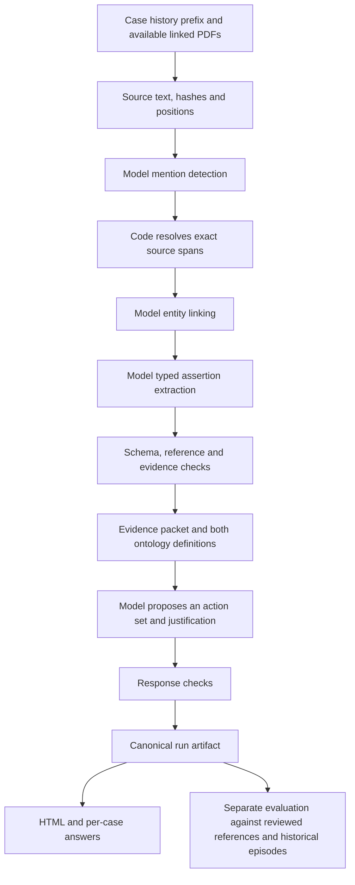

# Property evidence and decision evaluation

An experimental pipeline for turning property-management case histories into
source-linked evidence and structured next-action proposals. Built against the
[Dwelly public cases](https://github.com/DwellyOrg/HackatonPublicCases).

[Watch the project video](video/out/plasm-hackathon.mp4).

## 1. What we built

Two static, hand-authored ontologies and a Python pipeline:

- **Evidence ontology:** entities, identity links, attributed assertions, document
  observations, workflow conditions, human intervention and explicit gaps.
- **Response ontology:** one or more proposed actions, dependencies, evidence
  citations, concise model-authored justification and escalation causes.
- **Evaluation and inspection:** deterministic schema/reference/span checks,
  reviewed extraction probes, and separate model-assisted comparisons with
  historical agency actions.

Every completed decision run produces a canonical `run.json`, an adjacent HTML
viewer, and `ANSWERS/<case>/ANSWER.md` plus `REASONING.md`. These are projections of
the saved run: the renderer does not invent reasoning or improve the decisions.
The artifact retains inputs, prompts, raw responses, diagnostics, cost, latency
and provider-reported cache usage.

## 2. What operational problem it solves

A property case spreads information across messages, reports, approvals and
follow-ups. Before choosing an action, an agent needs to distinguish who and what
each statement concerns, what was reported, what was authorized, what is missing,
and which source supports each conclusion.

This prototype makes that interpretation inspectable. A reviewer can follow a
proposed action back through extracted claims to original event text or an
attachment page. It helps diagnose extraction and decision failures and compare
prompt changes. It does not execute property-management work or establish the
actual state of a CRM.

## 3. Architecture



Models instantiate the ontology; code resolves offsets and checks structural
constraints. An exact citation proves where text came from, not that the model
interpreted it correctly. Historical agreement and evidence support are scored
separately. A historical decision point can contain several agency actions.

Attachment text goes through the same entity and assertion extraction stages as
events. Only files linked within the supplied prefix are loaded. PDF provenance
includes file hash, page, and end-exclusive Unicode positions in extracted text.

The optimized runner uses short model-facing IDs, shared source metadata, a
single case-local entity graph and parallel assertion batches. Shared context
precedes batch-specific instructions to support prefix caching. Output exhaustion
triggers bounded source subdivision; partial responses remain recorded failures.

Contracts: [run artifacts](docs/run-artifact-format.md),
[evidence ontology](docs/static-ontology.md),
[observations](docs/observation-ontology-v7.md),
[response ontology](docs/response-ontology.md),
[decision episodes](docs/decision-episode-contract.md).

## 4. How to run it

Requirements: Python 3.12+, `uv`, a local copy of the public cases, and an
OpenRouter API key for model calls. Run these commands from this repository root.

```sh
uv sync --locked
# The versioned public input is included under data/property-management.
```

Set `OPENROUTER_API_KEY` in your environment, or put it in a local, untracked
`.env` file and pass `--env-file .env` to the execution command below. Credentials
are not copied into run artifacts. Model execution incurs provider charges.

### Extract evidence and propose decisions for two attachment probes

This diagnostic uses case 010 through event 013 and case 020 through event 017.
Preparation freezes source hashes, schemas and the versioned decision prompt;
it makes no model calls. Use a new output directory for each experiment.

```sh
uv run python -m property_eval.attachment_extraction prepare \
  --input-dir data/property-management \
  --manifest experiments/attachment-demo.json \
  --output runs/attachment-demo

uv run python -m property_eval.attachment_extraction run \
  --input-dir data/property-management \
  --output runs/attachment-demo
```

Open `runs/attachment-demo/index.html`. Its adjacent `run.json` is the authoritative
record; per-case submission files are under `runs/attachment-demo/ANSWERS/`.
This runner uses `openai/gpt-6-luna` and a global cap of 24 concurrent requests.
The public dataset is included with [upstream provenance](data/README.md).
For a totally unseen directory, follow the [input format and holdout run instructions](docs/input-format.md).
Its prompt comes from
[`experiments/prompts/decision-role-v1.txt`](experiments/prompts/decision-role-v1.txt),
then is frozen into the new run. No prior run is required.

### Extract evidence for a development manifest

```sh
uv run property-extract \
  --input-dir data/property-management \
  --manifest experiments/decision-dev-v1.json \
  --output runs/development-extraction \
  --model openai/gpt-6-luna \
  --concurrency 24 --timeout 600 --max-tokens 14000
```

This command is extraction-only; it does not generate decisions or historical
judgments. Add `--dry-run` to prepare initial requests without model calls.
The manifest selects prefixes; running it with current code does not reproduce
an older frozen experiment's implementation.

To render a saved canonical artifact without model calls:

```sh
uv run python -m property_eval.render_run runs/attachment-demo/run.json \
  --output runs/attachment-demo/review.html
```

### Evaluate all 50 cases, including the holdout-labelled split

The [frozen protocol](experiments/full-eval-v1.md) fixes one prefix per case and
reports development, holdout and previously exposed case 041 separately.
Historical episode targets are supplied only to the later evaluation stage.

```sh
uv run python -m property_eval.attachment_extraction prepare \
  --input-dir data/property-management --manifest experiments/full-eval-v1.json \
  --output runs/full-eval-v1
uv run python -m property_eval.attachment_extraction run \
  --input-dir data/property-management --output runs/full-eval-v1
uv run python -m property_eval.evaluate_run runs/full-eval-v1 \
  --episodes annotations/decision-episodes-v1.json annotations/holdout-episodes-v1.json
```

Each execution command accepts `--env-file .env`. Historical comparison uses the
existing episode judge with up to 24 parallel requests. Its labels are advisory;
`evaluation-summary.json` separates them from deterministic validity checks.

Generated runs are Git-ignored. Include the desired run artifacts separately when
sharing a submission. Historical results are documented in
[attachment extraction v2](docs/results-attachment-extraction-v2.md) and
[decision episode evaluation](docs/results-decision-episodes-v1.md).
The latest [50-case evaluation](docs/results-full-eval-v1.md) includes separately
reported development, holdout and previously exposed cases.

## 5. Models, APIs and external services used

| Component | Use |
|---|---|
| OpenRouter | Model API transport and provider-reported token, cost and cache accounting |
| `openai/gpt-6-luna` | Current extraction and decision model; also used in historical comparison experiments |
| Python, Pydantic | Typed ontologies, JSON schemas and deterministic validation |
| HTTPX, asyncio | HTTP requests and bounded parallel execution |
| pypdf | Local PDF text extraction |
| python-dotenv | Optional local credential loading |
| HTML/JavaScript | Local, source-linked review of saved artifacts |

There is no connected CRM, email, scheduling, maintenance or payment service.
The pipeline uses no agent framework. Model-assisted historical judging is
separate from the deterministic validators and is not part of the two-case
attachment diagnostic.

## 6. Key assumptions

- The event prefix defines what is available to the model. Later events and
  outcome summaries are excluded from decision input.
- A document becomes available through its explicit prefix link. Its reported
  date and the date it became available are different facts.
- Landlord, tenant and agent roles can identify case-local parties without
  personal names or CRM IDs. Genuine referent ambiguity must remain explicit.
- Extracted assertions preserve attribution, uncertainty and negation. They are
  evidence about the world, not authoritative world state.
- Historical agency actions are soft comparison targets. They may be incomplete,
  poorly supported or wrong; matching them does not establish operational success.
- Development work uses cases 001–040. This repository does not claim a pristine
  holdout or demonstrated generalization to unseen workflows.

## 7. Known limitations

**The ontology is static and inferred from semi-structured event logs. It will
not generalize reliably beyond the concepts and workflows it was authored to
represent.** A valid JSON response can still omit a crucial concept, assign the
wrong identity, or force evidence into an unsuitable category.

The logs do not specify a complete environment: initial state, available tools,
permissions, business rules and state transitions are underspecified. We cannot
reconstruct deterministic operational state from them. This is currently a
prefix-interpretation and next-choice prediction experiment, not an interactive
agent benchmark.

Other observed limits include document coreference failures, missing request
entities, incomplete or incorrect field citations, and action choices that stop
unnecessarily on uncertainty. PDF text extraction does not provide OCR or visual
understanding. Shared context across assertion batches does not automatically
reconcile record-level relationships across those batches.

Deterministic checks establish structural validity and source alignment, not
semantic completeness or entailment. Model judges add their own uncertainty.
The latest attachment comparison covered two development prefixes and changed
ontology, representation and batching together; it is not evidence of general
accuracy or an isolated prompt improvement. Adaptive subdivision is implemented
and locally tested, but was added after that measured run.

## 8. What we would build next

1. **Specify the agent's environment.** Define the systems it can access, their
   entities, tool/API contracts, permissions, observable state and permitted
   mutations. Derive the operational ontology from those contracts.
2. **Build evaluation and simulation services.** Provide isolated, seeded case
   state, deterministic transitions, a controlled clock, external-party events,
   and an auditable action log. Separate agent actions from tenant, landlord,
   contractor and environment behavior.
3. **Create datasets against that environment.** Include initial state, timed
   observations, attachments, alternative valid action sequences, escalation
   conditions and outcomes. Reserve unseen scenarios and workflow variants for
   evaluation; do not infer their hidden state retrospectively from prose.
4. **Define scoring criteria before tuning.** Measure task completion, valid state
   changes, authorization, timing, dependencies, evidence support, appropriate
   human escalation, unnecessary actions, cost and latency. Use deterministic
   state predicates wherever possible and explicitly delimit semantic judging.
5. **Evaluate the complete agent loop.** Observe, decide, execute, receive new
   evidence and recover from failure. Compare policies and prompts on fixed
   scenarios, then test generalization on the reserved scenarios.

The current extraction and provenance pipeline can supply observations to that
environment and help inspect failures. The environment specification supplies
the operational ground truth that these event logs currently lack.
